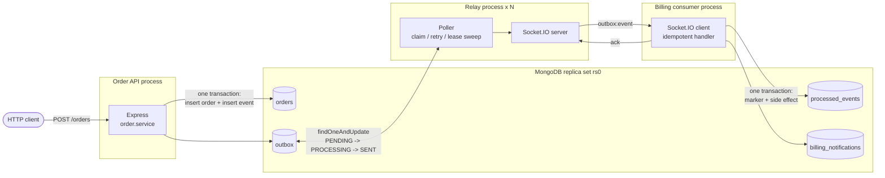

# outbox-relay

A production-shaped implementation of the **Transactional Outbox pattern** on
Node.js, Express, MongoDB multi-document transactions and Socket.IO, with
idempotent consumers, failure-injection demos and a benchmark suite.

**Measured on a laptop** (i7-13650HX, MongoDB 7.0 single-node replica set in
Docker Desktop; full details in [RESULTS.md](RESULTS.md)):

| | |
| --- | --- |
| Events lost at a 1% injected crash rate | **0 of 10,000** (naive dual-write: 107 lost, 1.07%) |
| Order + outbox transaction latency at 200 orders/sec | **p50 7.8 ms / p99 13 ms** |
| Commit -> consumer lag at 200 orders/sec (10 ms poll) | **p50 35 ms** |
| Write throughput at saturation (relay + consumer on the same DB) | **418 orders/sec** |
| Backlog drain, 50,000 events | **381 events/sec** (1 relay), **502 events/sec** (2 relays), 0 double claims |
| Recovery after a relay crash | **9,555 stranded events delivered in 31 s**, 0 lost |
| Tests | **82 tests, 98.9% statement / 93.1% branch coverage** |

## Contents

- [The problem: dual writes](#the-problem-dual-writes)
- [The fix: a transactional outbox](#the-fix-a-transactional-outbox)
- [Architecture](#architecture)
- [Delivery guarantees](#delivery-guarantees)
- [Why MongoDB needs a replica set here](#why-mongodb-needs-a-replica-set-here)
- [Running it locally](#running-it-locally)
- [Failure demos](#failure-demos)
- [Benchmarks](#benchmarks)
- [Tests](#tests)
- [Trade-offs and design decisions](#trade-offs-and-design-decisions)
- [Project layout](#project-layout)

## The problem: dual writes

An order service has to do two things when an order is placed: save the order,
and tell the rest of the system (billing, shipping, email) that it happened.
The obvious code writes to two systems one after the other:

```js
await db.orders.insertOne(order);     // write #1
socket.emit('OrderCreated', event);   // write #2
```

There is no transaction spanning a database and a message channel, so any
failure between the two lines (a crash, a deploy, an OOM kill, a network
partition, the broker being down) leaves an order that was saved but never
announced. Billing never hears about it, and nothing ever notices. Reversing
the order is no better: then you can announce an order that was never saved.

The benchmark's [baseline run](#benchmarks) makes this concrete: with a 1%
injected crash rate between the two writes, the naive version silently lost
about 1% of its events.

## The fix: a transactional outbox

Write the event **into the same database, in the same transaction** as the
business data, and let a separate process publish it:

1. `POST /orders` opens a MongoDB session and, inside `session.withTransaction`,
   inserts the order into `orders` **and** an `OrderCreated` row into `outbox`
   (`status: PENDING`). Either both commit or neither does. The request path
   never touches Socket.IO.
2. The **relay** (a separate process) polls `outbox` for due `PENDING` rows,
   claims each one atomically (`findOneAndUpdate` `PENDING -> PROCESSING` plus a
   lease), and emits it over Socket.IO.
3. When every subscribed consumer **acks**, the row is marked `SENT`. If a
   delivery fails, the row goes back to `PENDING` with exponential backoff;
   after `MAX_ATTEMPTS` it is parked as `FAILED` (a dead-letter state).
4. **Consumers are idempotent.** Each one records the event id in
   `processed_events` in the same transaction as its own side effect, so an
   event delivered twice is processed once.

If the API commits, the event will be published, however long it takes. If it
does not commit, there is no event.

## Architecture



Lifecycle of an outbox row:

```
             claim (findOneAndUpdate, lease)          all consumers acked
  PENDING  ------------------------------------>  PROCESSING  ------------>  SENT
     ^                                               |   |
     |   delivery failed (attempts < max), backoff   |   |  attempts == max
     +-----------------------------------------------+   +-------------->  FAILED
     |                                                   |
     +---------------------------------------------------+
         lease expired (relay crashed or hung): released for redelivery
```

## Delivery guarantees

| Failure | What happens | Outcome |
| --- | --- | --- |
| API crashes before commit | Transaction aborts; neither order nor event exists | Consistent: no order, no event |
| API crashes after commit | Event row is durable (`w:majority`); relay publishes it | Delivered |
| Relay is down | Rows accumulate as `PENDING`; the API keeps accepting orders | Delivered on restart |
| Relay crashes after claiming, before emitting | Row stays `PROCESSING` until its lease expires, then is released and reclaimed | Delivered |
| Relay crashes **after** the consumer acked, **before** marking `SENT` | Lease expires, event is redelivered | Delivered twice, **processed once** (consumer dedupes) |
| Consumer is down / slow / nacks | Ack times out or is negative; row retried with backoff | Delivered when consumer recovers, or `FAILED` after `MAX_ATTEMPTS` |
| Two relays poll concurrently | `findOneAndUpdate` is atomic per document; a row can only be claimed by one | No double claims |

This is **at-least-once delivery with effectively-once processing**. The
"crash after emit, before mark-as-sent" window cannot be closed on the
publisher side (the emit and the database update are, again, two different
systems), so it is handled where it can be: in the consumer, by making
processing idempotent.

## Why MongoDB needs a replica set here

Multi-document transactions are built on the replica set's oplog and
majority-commit machinery. A standalone `mongod` rejects
`session.withTransaction` with *"Transaction numbers are only allowed on a
replica set member or mongos"*. So even locally, MongoDB runs as a
**single-node replica set**:

- `docker-compose.yml` starts `mongod --replSet rs0`, and its healthcheck runs
  `rs.initiate()` on first boot and only reports healthy once the node is a
  writable primary. Application containers wait on that healthcheck.
- `src/db/mongo.js` checks the `hello` response at startup and refuses to run
  against a standalone server, rather than failing on the first order.
- The member is registered as `mongo:27017`, which only resolves inside the
  Compose network. Processes on the host (tests against Docker, demos,
  benchmarks) connect with `?directConnection=true` and skip replica-set
  discovery. Transactions still work because that connection goes straight to
  the primary.

## Running it locally

Requirements: Docker (with Compose) and Node.js 20+.

```bash
# Everything in containers: mongo (replica set), api, relay, consumer
docker compose up --build

# Create an order
curl -s -X POST localhost:3000/orders -H 'content-type: application/json' \
  -d '{"customer_id":"c-1","items":[{"sku":"BOOK-1","quantity":2,"unit_price_cents":1250}]}'

# Watch the consumer bill it
docker compose logs -f consumer      # ... "billing notified for order 6ad6..."

# Relay health and outbox counts by status
curl -s localhost:4000/stats
```

Or run only MongoDB in Docker and the services on the host:

```bash
docker compose up -d mongo
npm install
npm run start:relay      # terminal 1
npm run start:consumer   # terminal 2  (MONGO_URI=mongodb://localhost:27017/billing?directConnection=true)
npm run start:api        # terminal 3
```

Configuration is environment-only; see [`.env.example`](.env.example) for every
knob (`POLL_INTERVAL_MS`, `BATCH_SIZE`, `MAX_IN_FLIGHT_BATCHES`, `LEASE_MS`,
`ACK_TIMEOUT_MS`, `MAX_ATTEMPTS`, `BACKOFF_*`, `CONSUMER_CONCURRENCY`,
`RELAY_URLS`, `RELAY_AUTH_TOKEN`). When running on the host, export the same
`RELAY_AUTH_TOKEN` for the relay and the consumer.

To run a second relay against the same outbox, start another relay process on
a different `SOCKET_PORT` and list both in the consumer's `RELAY_URLS`.

## Failure demos

Both need `docker compose up -d mongo` and use separate databases.

```bash
npm run demo:crash
```

Starts the API, the consumer, and a relay rigged to `process.exit` right
after its 5th successful emit, i.e. after the consumer has processed the event
but before the row is marked `SENT`. While the relay is dead the API keeps
accepting orders. A fresh relay is then started; once the dead relay's leases
expire, everything is delivered. The demo verifies that every order has a
`SENT` event, billing was notified exactly once per order, and the
redeliveries were absorbed as duplicates.

```bash
npm run demo:duplicate
```

Delivers the same event to the consumer 8 times (3 sequential redeliveries,
then 5 concurrent copies racing each other) through the real Socket.IO
transport, and verifies a single billing notification and 7 acknowledged
duplicates.

## Benchmarks

```bash
docker compose up -d mongo
npm run bench             # full suite, ~15 minutes, writes RESULTS.md
npm run bench -- --quick  # small sizes, ~1 minute
```

The suite drives the real `api`, `relay` and `consumer` entrypoints as
separate Node processes against one MongoDB, with per-event logging off. Load
is generated with an [undici](https://github.com/nodejs/undici) connection
pool. End-to-end latency is measured from the commit timestamp returned by the
API to the receipt timestamp recorded by the consumer (both high-resolution
wall clocks on the same host).

Selected results (full tables, environment and methodology in
[RESULTS.md](RESULTS.md)):

**Consistency under failure.** Same load, same fault: for 1% of events the
process "dies" between the database write and the publish.

| Design | Orders | Events lost | Throughput | Request p50 | Request p99 |
| --- | --- | --- | --- | --- | --- |
| Naive dual-write | 10,000 | 107 (1.07%) | 892 orders/sec | 70.8 ms | 93.8 ms |
| Transactional outbox | 10,000 | **0** | 498 orders/sec | 110 ms | 154.6 ms |

The outbox is slower on the write path (a multi-document transaction instead
of a single insert, plus a relay hop) and in exchange never loses an event.
That is the honest comparison; it is not a speed-up.

**Outbox lag vs poll interval** (commit -> consumer receipt, 200 orders/sec):

| Poll interval | p50 | p95 | p99 |
| --- | --- | --- | --- |
| 10 ms | 34.6 ms | 102.1 ms | 151.2 ms |
| 50 ms | 132.8 ms | 258.8 ms | 295.3 ms |
| 100 ms | 214.6 ms | 279.5 ms | 305.8 ms |

**Backlog drain** (rows already `PENDING`, time until all are processed):

| Backlog | Relays | Drain time | Throughput | Double claims |
| --- | --- | --- | --- | --- |
| 1,000 | 1 | 2.7 s | 376 events/sec | 0 |
| 10,000 | 1 | 23.9 s | 418 events/sec | 0 |
| 50,000 | 1 | 131.1 s | 381 events/sec | 0 |
| 50,000 | 2 | 99.6 s | 502 events/sec | 0 |

Drain time grows linearly with backlog size (constant rate per relay), and a
second relay adds ~30% because the shared bottleneck is the consumer's durable
transaction per event, not claiming.

**What limits these numbers.** Every order and every consumer side effect is a
durable `w:majority` commit, which on Docker Desktop's virtualised disk costs a
few milliseconds of journal flush. The API, relay, consumer and load generator
also share one laptop and one `mongod`. Expect higher absolute numbers on a
dedicated Linux host; the relative results (zero loss, no double claims,
linear drain) are the point.

## Tests

```bash
npm test               # unit + integration
npm run test:coverage  # with istanbul coverage
npm run lint           # eslint
```

Tests run against an in-memory **single-node replica set**
([mongodb-memory-server](https://github.com/typegoose/mongodb-memory-server)),
so transactions are real and Docker is not needed.

- **Unit:** order validation, the order + outbox transaction (including
  rollback when either insert fails and 1:1 orders-to-events under concurrent
  writes), claim ordering, no double claims across 4 concurrent claimers,
  lease-holder checks, backoff and dead-lettering, lease recovery, dead-letter
  requeue, the relay loop (pipelining, fault hooks, error resilience), the
  Socket.IO transport (no subscribers, nacks, ack timeouts, token
  authentication), consumer idempotency (sequential and concurrent duplicates,
  rollback on handler failure), the HTTP layer, and the refusal to start
  against a standalone `mongod`.
- **Integration:** `POST /orders` -> transaction -> relay claim -> Socket.IO ->
  consumer -> `processed_events` + `billing_notifications` -> outbox `SENT`,
  plus two relays sharing one outbox, failure after emit, lease expiry after a
  dead relay, and delivery once a consumer connects late.

Current result: **82 tests passing, 98.9% statements / 93.1% branches / 97.8%
functions** (istanbul). The process entrypoints and the benchmark-only naive
baseline are excluded from coverage; they only wire configuration into the
tested modules and are exercised as real processes by the demos and the
benchmark.

## Trade-offs and design decisions

**Socket.IO is not a durable queue.** It has no persistence, no replay and no
consumer groups. Durability comes entirely from the outbox table: an event
stays `PENDING`/`PROCESSING` until a consumer acks it, so a consumer that is
offline simply receives it later. What Socket.IO costs you compared to Kafka or
RabbitMQ: fan-out is "every connected subscriber must ack", a slow subscriber
holds up the row, there is no per-consumer offset, and a subscriber that
connects after a row was `SENT` never sees it. For a real multi-team system the
relay would publish to a broker instead; the outbox side would not change.

**At-least-once, not exactly-once.** Exactly-once delivery across a network is
not achievable; the system instead guarantees no loss and makes duplicates
harmless with an idempotency key (the outbox row id) checked transactionally
by the consumer.

**Polling interval vs latency vs load.** The relay sleeps for
`POLL_INTERVAL_MS` only when it finds less than a full batch; under backlog it
claims back-to-back. A shorter interval cuts idle-time lag but issues more
empty queries. A MongoDB change stream on `outbox` could replace polling and
push latency down further; polling was kept because it is simpler to reason
about, survives resume-token loss, and is what the claim/lease design needs
anyway for retries and recovery.

**Relay bookkeeping uses `w:1`; the producer uses `w:majority`.** The order +
outbox transaction is the write that must never be lost, so it waits for
majority. Claims and `SENT` markers only decide *whether to deliver again*: if
one is lost in a failover, the event is redelivered and the consumer dedupes
it. Waiting for majority on them cost ~3.5 ms per claim on this setup and
roughly halved relay throughput.

**One-by-one claims.** Each claim is a separate `findOneAndUpdate`, which is
what makes concurrent relays safe without locks, at the cost of one round trip
per event. A batched claim (`find` N ids, then `updateMany` with a
`status: PENDING` guard and a claim token) trades that for more complex code;
with the consumer being the bottleneck here it was not worth it.

**Pipelining and bounded consumer concurrency.** The relay claims the next
batch while the previous one waits for acks (`MAX_IN_FLIGHT_BATCHES`), and the
consumer processes at most `CONSUMER_CONCURRENCY` events at a time. Profiling
showed that letting a 100-event batch become 100 concurrent consumer
transactions caused ~12% of them to abort on write conflicts, which halved
throughput and pushed acks past the relay's timeout, causing needless
redeliveries.

**Ordering.** Rows are claimed oldest-first, but events in a batch are
delivered concurrently, batches are pipelined, multiple relays run in
parallel, and retries reorder failed events. Consumers must not assume global
order. If per-aggregate ordering mattered, the relay would partition by
`aggregate_id` and deliver each partition serially.

**Lease length.** `LEASE_MS` must exceed `ACK_TIMEOUT_MS` (enforced at
startup), otherwise a row could be released and reclaimed while its first
delivery is still waiting for an ack. Longer leases mean slower recovery after
a crash; shorter ones risk redundant redeliveries.

**Dead letters are parked, not dropped.** After `MAX_ATTEMPTS` a row becomes
`FAILED` and stays in the outbox with its `last_error`. Once the cause is fixed,
`npm run outbox:requeue-failed [-- <eventId> ...]` puts them back to `PENDING`
with a fresh attempt budget.

**Consumer authentication.** Consumers present `RELAY_AUTH_TOKEN` in the
Socket.IO handshake, compared in constant time. Because a row is only `SENT`
once *every* subscriber acks, an unauthenticated hub would let any client read
order events or stall delivery by subscribing and never acking. A shared secret
is the minimum; per-consumer credentials plus TLS would be the production step.

**Lease timing assumes sane clocks.** Leases are stamped and checked with each
relay's wall clock. Multiple relays on different hosts need clock skew well
below `LEASE_MS` (NTP gives milliseconds against a 10 s lease). Using the
server's `$$NOW` instead would remove the assumption at the cost of
aggregation-pipeline updates in the claim path.

**Outbox and dedupe-table growth.** `SENT` rows are kept for auditability. In
production a TTL index on `sent_at` (or a periodic archive job) would bound the
collection. The consumer's `processed_events` can be expired the same way, as
long as its retention comfortably exceeds the longest possible redelivery
window (lease + full retry schedule), otherwise a very late duplicate would be
processed again.

## Project layout

```
src/
  config.js                 env parsing
  app.js                    Express app factory
  db/                       Mongo client (replica-set check), indexes
  orders/                   validation, transactional order service, routes
  outbox/                   event shape, repository (claim/lease/retry), backoff
  relay/                    poll loop, Socket.IO hub + transport, fault hooks
  consumer/                 billing consumer, transactional idempotency store
  shared/                   logger, protocol constants, semaphore, lifecycle
  baseline/naive-api.js     naive dual-write, benchmark only
  entrypoints/              api.js, relay.js, consumer.js
scripts/                    crash-recovery and duplicate-delivery demos
bench/                      benchmark scenarios, load generator, report
test/                       unit + integration tests (in-memory replica set)
```
